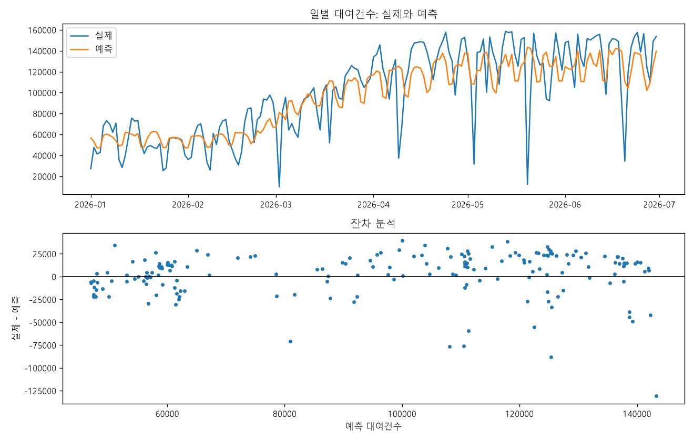

# 따릉이 이용량 × 날씨 데이터 분석 프로젝트

## 5회차 머신러닝 후속 작업: 일별 수요 예측

4회차 분석을 이어받아 **다음 날 서울시 전체 따릉이 총 대여건수**를 예측한다(회귀, F501~F508).
과거 대여건수와 달력 정보만 사용해, 예측 시점에 실제로 쓸 수 있는 모델을 만들고 평가했다.

- 문서: [실행·평가 조건](docs/ml/README.md) · [실행 결과](docs/ml/RESULTS.md) · [요구사항](docs/ml/REQUIREMENTS.md) · [데이터 준비 기록](docs/ml/DATA.md) · [4회차 EDA 요약](docs/ml/EDA_SUMMARY.md)
- 과제 저장소: [GitLab 05-pjt](https://lab.ssafy.com/totori0710/05-pjt)
- 원본 데이터는 GitHub에 포함하지 않는다. 재실행 전에 `scripts/download_ml_data.py`로 공개 CSV를 내려받는다.

### 문제 정의

| 항목 | 내용 |
|---|---|
| 예측 대상 | D일 서울시 전체 따릉이 총 대여건수 (회귀) |
| 예측 시점 | D-1일 00:00 |
| 입력 | D-2일까지 확정된 대여건수의 지연값·이동평균, D일의 요일·연중 주기·주말 여부 (10개) |
| 제외 | 당일 관측 날씨, D-1일 이후 대여건수 (예측 시점에 알 수 없음) |
| 활용 | 전일 기준 정비·재배치 인력과 차량 규모 계획의 참고 지표 |

### 요구사항별 결과 위치

| 명세 | 요구사항 | 노트북 | 핵심 내용 |
|---|---|---|---|
| F501 | 머신러닝 문제 정의 | [01](notebooks/ml/01.ipynb) | 예측 대상·시점·입력·활용 목적 |
| F502 | 전처리·피처 구성 및 누수 점검 | [02](notebooks/ml/02.ipynb) | 피처 10개, D-1 이후 값이 바뀌어도 피처가 변하지 않음을 검증 |
| F503 | 데이터 분할 및 기준선 설정 | [03](notebooks/ml/03.ipynb) | 시간순 학습·검증·테스트, 학습 평균·전주 동일 요일 기준선 |
| F504 | 모델 학습 및 성능 비교 | [04](notebooks/ml/04.ipynb) | Ridge vs Random Forest, MAE·RMSE·WAPE·R² |
| F505 | 교차검증 및 하이퍼파라미터 조정 | [05](notebooks/ml/05.ipynb) | TimeSeriesSplit(3분할, gap 1일), CV 평균 MAE로 선정 |
| F506 | 최종 평가 및 결과 해석 | [06](notebooks/ml/06.ipynb) | 테스트 평가, 월·요일·수요 구간별 오차, 순열 중요도, 4회차 EDA와 연결 |
| F507 | 모델 활용 방안 및 한계 | [07](notebooks/ml/07.ipynb) | 입출력 예시, 2026-07-01·02 실제 예측, 적용 범위·한계·개선 |
| F508 | 추가 실험 및 모델 개선 (선택) | [08](notebooks/ml/08.ipynb) | 공휴일 피처를 같은 조건에서 비교, 미채택 |

### 핵심 결과

최종 테스트는 2026-01-01~06-30의 181일이며, 모델 선정에는 사용하지 않았다.

| 방법 | MAE (건/일) | RMSE (건/일) | WAPE |
|---|---:|---:|---:|
| 학습 평균 | 36,256 | 42,014 | 36.50% |
| 전주 동일 요일 | 21,047 | 32,581 | 21.19% |
| **선정 Random Forest** | **18,370** | **24,710** | **18.49%** |

- 선정 모델의 MAE는 전주 동일 요일 기준선보다 **12.72% 낮다**. 설정은 max_depth=3, min_samples_leaf=7, n_estimators=200이다.
- 의존도가 큰 입력은 `rolling_7`과 `year_cos`다. 4회차 EDA에서 확인한 강한 계절성과 같은 방향이다.
- 오차는 4~5월 수요 상승기, 저수요일(WAPE 34.5%), 평일 공휴일에 크다.
- 4회차 F406의 날씨+달력 회귀는 MAE가 12,383건이었다. 다만 당일 관측 날씨를 쓴 사후 실험이라 직접 비교할 수 없으며, 기상예보를 결합할 때의 개선 여지로 해석했다.
- 공휴일 피처(F508)는 CV MAE가 +0.12%로 개선되지 않아 채택하지 않았다.



### 실행

```powershell
python -m venv .venv
.venv\Scripts\python.exe -m pip install -r requirements.txt
.venv\Scripts\python.exe scripts/download_ml_data.py      # 따릉이 CSV 3개를 data/raw/에 저장
.venv\Scripts\python.exe -m unittest discover -s tests -v  # 누수·분할·예측 시점·공휴일 검사 7개
.venv\Scripts\python.exe scripts/run_ml.py                 # 노트북 01~08 생성·실행
```

모델 사용 예(`src/ml/predict.py`)와 단계별 실행 순서는 [docs/ml/README.md](docs/ml/README.md)에 있다.

### 한계와 개선 방향

- 날씨·공휴일·운영 변화가 입력에 없다. 우선 개선 과제는 **전일 발행 기상예보 결합**이다.
- 학습자료는 약 1년, 테스트는 상반기뿐이다. 테스트 기간은 4회차 EDA에서 이미 관찰한 기간이다.
- 서울시 전체 총량을 예측하므로 대여소·시간대별 배치에는 별도 자료와 모델이 필요하다.

---

## 4회차 데이터 분석 (F401~F406)

아래 내용과 루트 PLAN/HANDOFF는 기존 4회차 분석 기록입니다.

서울시 공공자전거(따릉이) 일별 대여건수와 기상청 ASOS 일별 기상 데이터를 결합해
날씨가 자전거 이용량에 미치는 영향을 분석한다.

- 요구사항/실행계획: [PLAN.md](PLAN.md)
- **F405~F406 인수인계 문서: [HANDOFF.md](HANDOFF.md)** (F401~F404 완료 상태에서 이어받는 사람용)
- 데이터 수집 기록(F402): [docs/data_collection_log.md](docs/data_collection_log.md)
- 협업 방식(Git): [docs/collaboration_guide.md](docs/collaboration_guide.md)
- 원본 데이터와 명세서 PDF는 이 공개 저장소에 포함하지 않습니다.

## 폴더 구조
```
data/raw/        원본 데이터 (수정 금지)
data/processed/  정제·병합된 데이터
notebooks/       분석 ipynb
docs/            기록·가이드 문서
```

## 실행 방법
```
python -m venv .venv
.venv\Scripts\python.exe -m pip install -r requirements.txt
.venv\Scripts\python.exe scripts/execute_notebook.py
```
원본 CSV(`data/raw/`)만 있으면 `notebooks/analysis.ipynb`를 처음부터 끝까지 실행해
`data/processed/`의 중간·최종 산출물(`merged_daily.csv` 등)이 재생성된다.


## F405·F406 검토 안내

- F405: 인사이트, 관찰/해석 구분, 한계와 후속 수요 예측 문제 작성 완료.
- F406: 날씨 회귀와 달력 변수를 추가한 회귀를 시간순으로 비교 완료.
- [검토 안내](docs/review_f405_f406.md)에서 결과와 검토 지점을 확인합니다.
- 결과 표·그림은 `outputs/f406/`에 있으며 실행 결과와 해석은 노트북에도 포함됩니다.
- 검토 대기 상태입니다. master 병합·최종 제출 전 담당자 검토가 필요합니다.
- GitLab에는 데이터를 포함하고 PDF는 제외합니다. 추후 GitHub 반영 시에는 데이터와 PDF를 모두 제외합니다.


## GitHub 공개본 실행 전 준비

GitLab master의 F401~F406 코드·결과를 반영한 공개본입니다. 원본/전처리 데이터와 명세서 PDF, 일별 실제값을 포함한 예측 CSV는 제외했습니다. 노트북의 요약 통계·그래프·실행 결과는 유지합니다.

재실행하려면 `docs/data_collection_log.md`의 출처와 기간에 맞는 원본 CSV 4개를 별도로 확보해 `data/raw/`에 배치해야 합니다. 파일명은 노트북 F401에서 확인할 수 있습니다. F403에서 `data/processed/merged_daily.csv`가 생성됩니다. 데이터 없이 저장된 노트북 결과와 해석을 열람하는 것은 가능합니다.

F405·F406은 GitLab master에 병합되었습니다. 검토 문서의 '검토 대기' 문구는 병합 전 작업 기록입니다.
